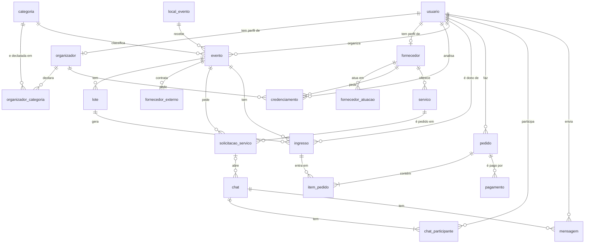

# Banco de Dados — TrocaTicket

O banco desta entrega está em **MySQL 8**, nos arquivos desta pasta:

- [`trocaticket_mysql.sql`](trocaticket_mysql.sql): cria o banco `trocaticket` com todas as tabelas, chaves e regras
- [`seed_mysql.sql`](seed_mysql.sql): dados iniciais (administrador e categorias)

O site publicado usa a mesma estrutura em **PostgreSQL** (Supabase), no arquivo [`Entrega1/tabelas_bd/trocaticket.sql`](../../Entrega1/tabelas_bd/trocaticket.sql). As tabelas, colunas e chaves são as mesmas nas duas versões.

Diagrama entidade-relacionamento da primeira entrega: [`Entrega1/Proj.BancodeDados/DER_TT.pdf`](../../Entrega1/Proj.BancodeDados/DER_TT.pdf)

## Tabelas

O banco tem 20 tabelas. Todas têm chave primária (PK), e as ligações entre elas são feitas por chaves estrangeiras (FK).

| Tabela | Para que serve | PK | FKs |
|---|---|---|---|
| `usuario` | Todas as contas (comprador, organizador, fornecedor e administrador) | `id_usuario` | — |
| `organizador` | Dados do credenciamento de um usuário organizador (pessoa física ou produtora) | `id_organizador` | `id_usuario` → `usuario` |
| `organizador_categoria` | Tipos de evento que o organizador declarou | `id_organizador` + `id_categoria` (composta) | `id_organizador` → `organizador`; `id_categoria` → `categoria` |
| `fornecedor` | Dados da empresa de um usuário fornecedor | `id_fornecedor` | `id_usuario` → `usuario` |
| `fornecedor_atuacao` | Áreas em que o fornecedor atua (iluminação, comida, bebida…) | `id_fornecedor` + `categoria` (composta) | `id_fornecedor` → `fornecedor` |
| `credenciamento` | Pedidos de credenciamento de organizadores e fornecedores, analisados pelo administrador (cada linha é de um dos dois) | `id_credenciamento` | `id_organizador` → `organizador`; `id_fornecedor` → `fornecedor`; `id_adm` → `usuario` |
| `servico` | Serviços que cada fornecedor oferece, com preço | `id_servico` | `id_fornecedor` → `fornecedor` |
| `categoria` | Categorias de evento (show, teatro, festival…) | `id_categoria` | — |
| `local_evento` | Locais onde os eventos acontecem | `id_local` | — |
| `evento` | Eventos criados pelos organizadores | `id_evento` | `id_organizador` → `usuario`; `id_local` → `local_evento`; `id_categoria` → `categoria`; `id_adm_revisor` → `usuario` |
| `lote` | Lotes de ingresso de um evento (setor, preço, quantidade, janela de venda e margem de revenda) **(extensão)** | `id_lote` | `id_evento` → `evento` |
| `fornecedor_externo` | Fornecedores que o organizador contratou por fora da plataforma | `id_fornecedor_externo` | `id_evento` → `evento` |
| `solicitacao_servico` | Pedido de um serviço de fornecedor para um evento | `id_solicitacao` | `id_evento` → `evento`; `id_servico` → `servico` |
| `ingresso` | Cada ingresso gerado a partir de um lote, com código único e dono atual **(extensão)** | `id_ingresso` | `id_evento` → `evento`; `id_lote` → `lote`; `id_vendedor` → `usuario` |
| `pedido` | Compras feitas por um usuário **(extensão)** | `id_pedido` | `id_comprador` → `usuario` |
| `item_pedido` | Ingressos de cada pedido **(extensão)** | `id_pedido` + `id_ingresso` (composta) | `id_pedido` → `pedido`; `id_ingresso` → `ingresso` |
| `pagamento` | Pagamento de um pedido **(extensão)** | `id_pagamento` | `id_pedido` → `pedido` |
| `chat` | Conversas | `id_chat` | `id_solicitacao` → `solicitacao_servico` |
| `chat_participante` | Quem participa de cada conversa | `id_chat` + `id_usuario` (composta) | `id_chat` → `chat`; `id_usuario` → `usuario` |
| `mensagem` | Mensagens de uma conversa | `id_mensagem` | `id_chat` → `chat`; `id_remetente` → `usuario` |

As tabelas marcadas como **(extensão)** ficaram fora do MVP e são detalhadas no fim da seção seguinte.

## Campos e tipos de dados

Os tipos abaixo são os do MySQL 8 (`trocaticket_mysql.sql`). **Obrigatório?** "Sim" quer dizer que o campo não aceita valor vazio (`NOT NULL`); campos com valor padrão são preenchidos sozinhos quando não informados. Na coluna **Chave**: `PK` é chave primária, `FK → tabela.campo` é chave estrangeira e `UNIQUE` quer dizer que o valor não pode se repetir.

### Fluxo principal

As tabelas abaixo sustentam o fluxo do MVP: contas, credenciamento, fornecedores, serviços, eventos, pedidos de serviço e chat.

#### `usuario`

Todas as contas do site, de qualquer perfil.

| Campo | Tipo | Obrigatório? | Chave | Descrição |
|---|---|---|---|---|
| `id_usuario` | `INT` | Sim | PK | Identificador da conta (gerado automaticamente). |
| `nome` | `VARCHAR(120)` | Sim | — | Nome completo. |
| `email` | `VARCHAR(160)` | Sim | UNIQUE | E-mail usado no login. Sempre guardado em minúsculas. |
| `cpf` | `VARCHAR(14)` | Sim | UNIQUE | CPF da pessoa. |
| `senha_hash` | `VARCHAR(255)` | Sim | — | Senha criptografada (nunca a senha em texto puro). |
| `telefone` | `VARCHAR(20)` | Não | — | Telefone de contato. |
| `tipo` | `VARCHAR(30)` | Sim | — | Perfil da conta: `comprador`, `organizador`, `fornecedor` ou `adm`. Padrão: `'comprador'`. |
| `criado_em` | `DATETIME` | Sim | — | Data e hora do cadastro. |

- `email` e `cpf` não podem se repetir (`UNIQUE`).
- O e-mail tem que estar em minúsculas (`CHECK`).

#### `organizador`

Dados do credenciamento de uma conta organizadora.

| Campo | Tipo | Obrigatório? | Chave | Descrição |
|---|---|---|---|---|
| `id_organizador` | `INT` | Sim | PK | Identificador do perfil de organizador. |
| `id_usuario` | `INT` | Sim | FK → `usuario.id_usuario`, UNIQUE | Conta dona do perfil (cada conta tem no máximo um perfil de organizador). |
| `tipo_pessoa` | `VARCHAR(10)` | Sim | — | `fisica` (produtor independente, usa o CPF da conta) ou `juridica` (produtora). |
| `nome_organizacao` | `VARCHAR(140)` | Sim | — | Nome do organizador ou da produtora. |
| `razao_social` | `VARCHAR(160)` | Não | — | Razão social. Obrigatória para pessoa jurídica. |
| `cnpj` | `VARCHAR(14)` | Não | UNIQUE | CNPJ. Obrigatório para pessoa jurídica. |
| `cidade` | `VARCHAR(80)` | Sim | — | Cidade de atuação. |
| `estado` | `CHAR(2)` | Sim | — | Sigla do estado (UF). |
| `telefone` | `VARCHAR(20)` | Sim | — | Telefone de contato do organizador. |
| `descricao` | `TEXT` | Sim | — | Apresentação do organizador. |
| `link` | `VARCHAR(200)` | Não | — | Site ou rede social. |
| `publico_medio` | `INT` | Não | — | Público médio dos eventos (maior que zero). |
| `situacao` | `VARCHAR(30)` | Sim | — | Situação do credenciamento: `nao_solicitado`, `em_analise`, `credenciado` ou `recusado`. Padrão: `'em_analise'`. |
| `criado_em` | `DATETIME` | Sim | — | Data e hora em que a linha foi criada. |

- `id_usuario` e `cnpj` não podem se repetir (`UNIQUE`).
- Para pessoa jurídica, `razao_social` e `cnpj` são obrigatórios (`CHECK`).
- `publico_medio`, quando informado, tem que ser maior que zero (`CHECK`).
- Se a conta for apagada, o perfil vai junto (`ON DELETE CASCADE`).

#### `organizador_categoria`

Tipos de evento que o organizador declarou no credenciamento (liga `organizador` a `categoria`).

| Campo | Tipo | Obrigatório? | Chave | Descrição |
|---|---|---|---|---|
| `id_organizador` | `INT` | Sim | PK, FK → `organizador.id_organizador` | Organizador que declarou o tipo de evento. |
| `id_categoria` | `INT` | Sim | PK, FK → `categoria.id_categoria` | Categoria declarada. |

- A chave primária é composta: o mesmo organizador não repete a mesma categoria.

#### `fornecedor`

Dados da empresa de uma conta fornecedora.

| Campo | Tipo | Obrigatório? | Chave | Descrição |
|---|---|---|---|---|
| `id_fornecedor` | `INT` | Sim | PK | Identificador do perfil de fornecedor. |
| `id_usuario` | `INT` | Sim | FK → `usuario.id_usuario`, UNIQUE | Conta dona do perfil (cada conta tem no máximo um perfil de fornecedor). |
| `nome_empresa` | `VARCHAR(140)` | Sim | — | Nome fantasia da empresa. |
| `razao_social` | `VARCHAR(160)` | Não | — | Razão social. |
| `cnpj` | `VARCHAR(18)` | Sim | UNIQUE | CNPJ da empresa. |
| `cidade` | `VARCHAR(80)` | Não | — | Cidade da empresa. |
| `estado` | `CHAR(2)` | Não | — | Sigla do estado (UF). |
| `telefone` | `VARCHAR(20)` | Não | — | Telefone de contato. |
| `descricao` | `TEXT` | Não | — | Apresentação da empresa. |
| `link` | `VARCHAR(200)` | Não | — | Site ou rede social. |
| `situacao` | `VARCHAR(30)` | Sim | — | Situação do credenciamento: `nao_solicitado`, `em_analise`, `credenciado` ou `recusado`. Padrão: `'nao_solicitado'`. |
| `criado_em` | `DATETIME` | Sim | — | Data e hora em que a linha foi criada. |

- `id_usuario` e `cnpj` não podem se repetir (`UNIQUE`).
- Se a conta for apagada, o perfil vai junto (`ON DELETE CASCADE`).

#### `fornecedor_atuacao`

Áreas em que o fornecedor atua (as mesmas dos itens de custo do evento).

| Campo | Tipo | Obrigatório? | Chave | Descrição |
|---|---|---|---|---|
| `id_fornecedor` | `INT` | Sim | PK, FK → `fornecedor.id_fornecedor` | Fornecedor. |
| `categoria` | `VARCHAR(30)` | Sim | PK | Área de atuação: `iluminacao`, `comida`, `bebida`, `seguranca`, `estrutura` ou `outros`. |

- A chave primária é composta: o fornecedor não repete a mesma área.

#### `credenciamento`

Pedidos de credenciamento, analisados pelo administrador. Cada linha é de um organizador **ou** de um fornecedor, nunca dos dois.

| Campo | Tipo | Obrigatório? | Chave | Descrição |
|---|---|---|---|---|
| `id_credenciamento` | `INT` | Sim | PK | Identificador do pedido. |
| `id_fornecedor` | `INT` | Não | FK → `fornecedor.id_fornecedor` | Fornecedor que pediu. Fica nulo quando o pedido é de um organizador. |
| `id_organizador` | `INT` | Não | FK → `organizador.id_organizador` | Organizador que pediu. Fica nulo quando o pedido é de um fornecedor. |
| `id_adm` | `INT` | Não | FK → `usuario.id_usuario` | Administrador que analisou. Fica nulo enquanto não houver análise. |
| `status` | `VARCHAR(30)` | Sim | — | Andamento do pedido: `em_analise`, `aprovado` ou `recusado`. Padrão: `'em_analise'`. |
| `observacao` | `TEXT` | Não | — | Observação do administrador, como o motivo da recusa. |
| `solicitado_em` | `DATETIME` | Sim | — | Data e hora do envio do pedido. |
| `revisado_em` | `DATETIME` | Não | — | Data e hora da análise. Fica nulo até o administrador responder. |

- Exatamente um entre `id_fornecedor` e `id_organizador` é preenchido (`CHECK`).
- Se o administrador for apagado, `id_adm` volta a nulo (`ON DELETE SET NULL`).

#### `servico`

Serviços que cada fornecedor oferece, com preço.

| Campo | Tipo | Obrigatório? | Chave | Descrição |
|---|---|---|---|---|
| `id_servico` | `INT` | Sim | PK | Identificador do serviço. |
| `id_fornecedor` | `INT` | Sim | FK → `fornecedor.id_fornecedor` | Fornecedor que oferece o serviço. |
| `nome` | `VARCHAR(140)` | Sim | — | Nome do serviço. |
| `descricao` | `TEXT` | Não | — | Descrição do que está incluído. |
| `preco` | `DECIMAL(10,2)` | Sim | — | Preço do serviço, em reais. |
| `ativo` | `BOOLEAN` | Sim | — | Se o serviço está disponível para ser pedido. Padrão: `TRUE`. |
| `criado_em` | `DATETIME` | Sim | — | Data e hora em que a linha foi criada. |

- Se o fornecedor for apagado, os serviços vão junto (`ON DELETE CASCADE`).

#### `categoria`

Categorias de evento (show, teatro, festival…).

| Campo | Tipo | Obrigatório? | Chave | Descrição |
|---|---|---|---|---|
| `id_categoria` | `INT` | Sim | PK | Identificador da categoria. |
| `nome` | `VARCHAR(80)` | Sim | UNIQUE | Nome da categoria. |

- `nome` não pode se repetir (`UNIQUE`).

#### `local_evento`

Locais onde os eventos acontecem. O mesmo local é reaproveitado entre eventos.

| Campo | Tipo | Obrigatório? | Chave | Descrição |
|---|---|---|---|---|
| `id_local` | `INT` | Sim | PK | Identificador do local. |
| `nome` | `VARCHAR(140)` | Sim | — | Nome do local. |
| `cidade` | `VARCHAR(80)` | Sim | — | Cidade. |
| `estado` | `CHAR(2)` | Sim | — | Sigla do estado (UF). |
| `endereco` | `VARCHAR(200)` | Sim | — | Endereço completo. |

- Não pode haver dois locais com o mesmo `nome`, `cidade` e `estado` (`UNIQUE`).

#### `evento`

Eventos criados pelos organizadores. O evento só fica público depois de aprovado por um administrador.

| Campo | Tipo | Obrigatório? | Chave | Descrição |
|---|---|---|---|---|
| `id_evento` | `INT` | Sim | PK | Identificador do evento. |
| `id_organizador` | `INT` | Sim | FK → `usuario.id_usuario` | Conta (`usuario`) do organizador que criou o evento. |
| `id_local` | `INT` | Sim | FK → `local_evento.id_local` | Local onde o evento acontece. |
| `id_categoria` | `INT` | Sim | FK → `categoria.id_categoria` | Categoria do evento. |
| `nome` | `VARCHAR(160)` | Sim | — | Nome do evento. |
| `descricao` | `TEXT` | Não | — | Descrição do evento. |
| `data_hora` | `DATETIME` | Sim | — | Data e hora em que o evento acontece. |
| `status` | `VARCHAR(30)` | Sim | — | Situação do evento: `rascunho`, `em_analise`, `aprovado` ou `recusado`. Padrão: `'rascunho'`. |
| `motivo_recusa` | `TEXT` | Não | — | Motivo informado pelo administrador quando recusa. |
| `id_adm_revisor` | `INT` | Não | FK → `usuario.id_usuario` | Administrador que revisou. Fica nulo até a revisão. |
| `revisado_em` | `DATETIME` | Não | — | Data e hora da revisão. Fica nulo até a revisão. |
| `criado_em` | `DATETIME` | Sim | — | Data e hora em que a linha foi criada. |

- Se o administrador revisor for apagado, `id_adm_revisor` volta a nulo (`ON DELETE SET NULL`).

#### `fornecedor_externo`

Fornecedores que o organizador contratou por fora do site, sem conta. Servem para o administrador somar o custo do evento ao aprovar.

| Campo | Tipo | Obrigatório? | Chave | Descrição |
|---|---|---|---|---|
| `id_fornecedor_externo` | `INT` | Sim | PK | Identificador do registro. |
| `id_evento` | `INT` | Sim | FK → `evento.id_evento` | Evento em que o fornecedor foi contratado. |
| `nome` | `VARCHAR(140)` | Sim | — | Nome do fornecedor. |
| `servico` | `VARCHAR(140)` | Sim | — | Serviço contratado. |
| `valor` | `DECIMAL(10,2)` | Sim | — | Valor combinado, em reais. |
| `contato` | `VARCHAR(140)` | Não | — | Telefone ou e-mail do fornecedor. |

- Se o evento for apagado, os registros vão junto (`ON DELETE CASCADE`).

#### `solicitacao_servico`

Pedido de um serviço de fornecedor para um evento.

| Campo | Tipo | Obrigatório? | Chave | Descrição |
|---|---|---|---|---|
| `id_solicitacao` | `INT` | Sim | PK | Identificador do pedido. |
| `id_evento` | `INT` | Sim | FK → `evento.id_evento` | Evento que precisa do serviço. |
| `id_servico` | `INT` | Sim | FK → `servico.id_servico` | Serviço pedido. |
| `mensagem` | `TEXT` | Não | — | Mensagem do organizador ao fornecedor. |
| `valor_proposto` | `DECIMAL(10,2)` | Não | — | Valor que o organizador propõe, em reais. |
| `status` | `VARCHAR(30)` | Sim | — | Andamento: `aguardando_organizador` (retido até o administrador aprovar o organizador), `em_analise`, `aceita` ou `recusada`. Padrão: `'em_analise'`. |
| `criado_em` | `DATETIME` | Sim | — | Data e hora em que a linha foi criada. |
| `respondido_em` | `DATETIME` | Não | — | Data e hora da resposta do fornecedor. Fica nulo até responder. |

- O mesmo serviço só pode ser pedido uma vez por evento (`UNIQUE` em `id_evento` + `id_servico`).
- Se o evento for apagado, os pedidos vão junto (`ON DELETE CASCADE`).

#### `chat`

Conversas. Nasce de um pedido de serviço (organizador e fornecedor) ou aberta pelo administrador direto com um usuário.

| Campo | Tipo | Obrigatório? | Chave | Descrição |
|---|---|---|---|---|
| `id_chat` | `INT` | Sim | PK | Identificador da conversa. |
| `id_solicitacao` | `INT` | Não | FK → `solicitacao_servico.id_solicitacao`, UNIQUE | Pedido de serviço que originou a conversa. Fica nulo quando o administrador abre o chat. |
| `assunto` | `VARCHAR(140)` | Não | — | Assunto da conversa (usado nos chats abertos pelo administrador). |
| `criado_em` | `DATETIME` | Sim | — | Data e hora em que a linha foi criada. |

- Cada pedido de serviço tem no máximo um chat (`id_solicitacao` é `UNIQUE`).
- Se o pedido for apagado, o chat vai junto (`ON DELETE CASCADE`).

#### `chat_participante`

Quem participa de cada conversa.

| Campo | Tipo | Obrigatório? | Chave | Descrição |
|---|---|---|---|---|
| `id_chat` | `INT` | Sim | PK, FK → `chat.id_chat` | Conversa. |
| `id_usuario` | `INT` | Sim | PK, FK → `usuario.id_usuario` | Usuário participante. |

- A chave primária é composta: o usuário não entra duas vezes na mesma conversa.

#### `mensagem`

Mensagens de uma conversa.

| Campo | Tipo | Obrigatório? | Chave | Descrição |
|---|---|---|---|---|
| `id_mensagem` | `INT` | Sim | PK | Identificador da mensagem. |
| `id_chat` | `INT` | Sim | FK → `chat.id_chat` | Conversa em que a mensagem foi enviada. |
| `id_remetente` | `INT` | Sim | FK → `usuario.id_usuario` | Usuário que enviou. |
| `texto_mensagem` | `TEXT` | Sim | — | Texto da mensagem. |
| `criado_em` | `DATETIME` | Sim | — | Data e hora do envio. |

- Se a conversa for apagada, as mensagens vão junto (`ON DELETE CASCADE`).

### Tabelas de extensão (venda de ingressos)

Ficaram fora do MVP: lotes, ingressos, pedidos e pagamento. Continuam no banco e no script, mas são extensão do projeto, e não o foco desta entrega.

#### `lote`

Lotes de ingresso de um evento.

| Campo | Tipo | Obrigatório? | Chave | Descrição |
|---|---|---|---|---|
| `id_lote` | `INT` | Sim | PK | Identificador do lote. |
| `id_evento` | `INT` | Sim | FK → `evento.id_evento` | Evento a que o lote pertence. |
| `setor` | `VARCHAR(60)` | Sim | — | Onde a pessoa fica (pista, camarote…). |
| `nome` | `VARCHAR(80)` | Sim | — | Fase da venda (1º lote, 2º lote…). |
| `preco` | `DECIMAL(10,2)` | Sim | — | Preço de cada ingresso do lote, em reais. |
| `quantidade` | `INT` | Sim | — | Quantidade de ingressos do lote. |
| `data_inicio` | `DATETIME` | Sim | — | Início da venda. |
| `data_fim` | `DATETIME` | Sim | — | Fim da venda. |
| `margem_revenda` | `DECIMAL(5,2)` | Sim | — | Teto de revenda em %. Zero trava a revenda no preço original. Padrão: `0`. |
| `criado_em` | `DATETIME` | Sim | — | Data e hora em que a linha foi criada. |

- Não pode repetir `setor` + `nome` no mesmo evento (`UNIQUE`).
- `preco` e `margem_revenda` não podem ser negativos, e `quantidade` tem que ser maior que zero (`CHECK`).
- `data_fim` tem que ser depois de `data_inicio` (`CHECK`).
- Se o evento for apagado, os lotes vão junto (`ON DELETE CASCADE`).

#### `ingresso`

Cada ingresso gerado a partir de um lote, com código único e dono atual.

| Campo | Tipo | Obrigatório? | Chave | Descrição |
|---|---|---|---|---|
| `id_ingresso` | `INT` | Sim | PK | Identificador do ingresso. |
| `id_evento` | `INT` | Sim | FK → `evento.id_evento` | Evento do ingresso. |
| `id_lote` | `INT` | Sim | FK → `lote.id_lote` | Lote de origem. |
| `id_vendedor` | `INT` | Sim | FK → `usuario.id_usuario` | Dono atual: começa como o organizador e passa ao comprador depois da venda. |
| `setor` | `VARCHAR(60)` | Não | — | Setor do ingresso. |
| `tipo` | `VARCHAR(40)` | Não | — | Tipo do ingresso. |
| `codigo` | `VARCHAR(40)` | Sim | UNIQUE | Código único do ingresso. |
| `status` | `VARCHAR(30)` | Sim | — | Situação: `disponivel`, `vendido`, `a_venda`, `usado` ou `cancelado`. Padrão: `'disponivel'`. |
| `preco` | `DECIMAL(10,2)` | Sim | — | Preço atual, em reais. |

- `codigo` não pode se repetir (`UNIQUE`).
- Se o evento ou o lote forem apagados, os ingressos vão junto (`ON DELETE CASCADE`).

#### `pedido`

Compras feitas por um usuário.

| Campo | Tipo | Obrigatório? | Chave | Descrição |
|---|---|---|---|---|
| `id_pedido` | `INT` | Sim | PK | Identificador do pedido. |
| `id_comprador` | `INT` | Sim | FK → `usuario.id_usuario` | Usuário que comprou. |
| `data_pedido` | `DATETIME` | Sim | — | Data e hora da compra. |
| `valor_total` | `DECIMAL(10,2)` | Sim | — | Soma dos itens, em reais. |
| `status` | `VARCHAR(30)` | Sim | — | Situação: `aguardando_pagamento`, `pago` ou `cancelado`. Padrão: `'aguardando_pagamento'`. |

#### `item_pedido`

Ingressos de cada pedido. É também o histórico de revenda de cada ingresso.

| Campo | Tipo | Obrigatório? | Chave | Descrição |
|---|---|---|---|---|
| `id_pedido` | `INT` | Sim | PK, FK → `pedido.id_pedido` | Pedido. |
| `id_ingresso` | `INT` | Sim | PK, FK → `ingresso.id_ingresso` | Ingresso comprado. |
| `preco_unitario` | `DECIMAL(10,2)` | Sim | — | Preço pago nessa venda, em reais. |

- A chave primária é composta: o mesmo ingresso entra uma vez em cada pedido.

#### `pagamento`

Pagamento de um pedido.

| Campo | Tipo | Obrigatório? | Chave | Descrição |
|---|---|---|---|---|
| `id_pagamento` | `INT` | Sim | PK | Identificador do pagamento. |
| `id_pedido` | `INT` | Sim | FK → `pedido.id_pedido` | Pedido pago. |
| `metodo` | `VARCHAR(30)` | Sim | — | Forma de pagamento: `pix`, `cartao` ou `boleto`. |
| `status` | `VARCHAR(30)` | Sim | — | Situação: `pendente`, `aprovado` ou `recusado`. Padrão: `'pendente'`. |
| `valor` | `DECIMAL(10,2)` | Sim | — | Valor pago, em reais. |
| `data_pagamento` | `DATETIME` | Não | — | Data e hora do pagamento. Fica nulo enquanto pendente. |

- Se o pedido for apagado, o pagamento vai junto (`ON DELETE CASCADE`).

## Exemplo: `evento` e `lote`

**`evento`** guarda o evento. A PK é `id_evento`. Ele aponta para quem organizou (`id_organizador`), onde acontece (`id_local`) e a categoria (`id_categoria`). O campo `status` só aceita `rascunho`, `em_analise`, `aprovado` ou `recusado`.

**`lote`** guarda os lotes de ingresso. A PK é `id_lote` e a FK `id_evento` liga cada lote ao seu evento. Se o evento for apagado, os lotes vão junto (`ON DELETE CASCADE`). Regras:

- não pode repetir o mesmo `setor` + `nome` no mesmo evento (`UNIQUE`);
- preço não pode ser negativo e quantidade tem que ser maior que zero (`CHECK`);
- a venda tem que terminar depois de começar (`data_fim > data_inicio`).

## Diagrama

## Como criar o banco (MySQL Workbench)

1. Abrir o `trocaticket_mysql.sql` no MySQL Workbench e executar tudo (botão do raio).
2. Abrir o `seed_mysql.sql` e executar.
3. Conferir com `SHOW TABLES;` no banco `trocaticket`: são 20 tabelas.

O script apaga e recria o banco `trocaticket` do zero, então pode ser rodado de novo sempre que precisar.

## Diferenças para a versão PostgreSQL

| PostgreSQL (site) | MySQL (esta entrega) |
|---|---|
| `INT GENERATED BY DEFAULT AS IDENTITY` | `INT AUTO_INCREMENT` |
| `TIMESTAMP` | `DATETIME` |
| `DROP TABLE ... CASCADE` | `DROP DATABASE IF EXISTS trocaticket` |
| fuso horário do banco e RLS do Supabase | não se aplicam |

Precisa de MySQL 8.0.16 ou mais novo, porque as regras `CHECK` só funcionam a partir dessa versão.
