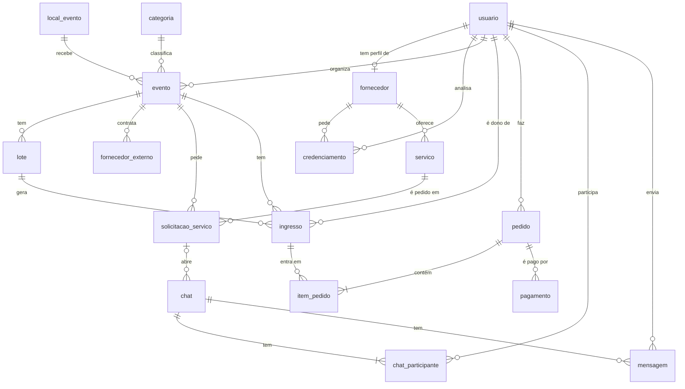

# Banco de Dados — TrocaTicket

O banco desta entrega está em **MySQL 8**, nos arquivos desta pasta:

- [`trocaticket_mysql.sql`](trocaticket_mysql.sql): cria o banco `trocaticket` com todas as tabelas, chaves e regras
- [`seed_mysql.sql`](seed_mysql.sql): dados iniciais (administrador e categorias)

O site publicado usa a mesma estrutura em **PostgreSQL** (Supabase), no arquivo [`Entrega1/tabelas_bd/trocaticket.sql`](../../Entrega1/tabelas_bd/trocaticket.sql). As tabelas, colunas e chaves são as mesmas nas duas versões.

Diagrama entidade-relacionamento da primeira entrega: [`Entrega1/Proj.BancodeDados/DER_TT.pdf`](../../Entrega1/Proj.BancodeDados/DER_TT.pdf)

## Tabelas

O banco tem 17 tabelas. Todas têm chave primária (PK), e as ligações entre elas são feitas por chaves estrangeiras (FK).

| Tabela | Para que serve | PK | FKs |
|---|---|---|---|
| `usuario` | Todas as contas (comprador, organizador, fornecedor e administrador) | `id_usuario` | — |
| `fornecedor` | Dados da empresa de um usuário fornecedor | `id_fornecedor` | `id_usuario` → `usuario` |
| `credenciamento` | Pedidos de credenciamento do fornecedor, analisados pelo administrador | `id_credenciamento` | `id_fornecedor` → `fornecedor`; `id_adm` → `usuario` |
| `servico` | Serviços que cada fornecedor oferece, com preço | `id_servico` | `id_fornecedor` → `fornecedor` |
| `categoria` | Categorias de evento (show, teatro, festival…) | `id_categoria` | — |
| `local_evento` | Locais onde os eventos acontecem | `id_local` | — |
| `evento` | Eventos criados pelos organizadores | `id_evento` | `id_organizador` → `usuario`; `id_local` → `local_evento`; `id_categoria` → `categoria`; `id_adm_revisor` → `usuario` |
| `lote` | Lotes de ingresso de um evento (setor, preço, quantidade, janela de venda e margem de revenda) | `id_lote` | `id_evento` → `evento` |
| `fornecedor_externo` | Fornecedores que o organizador contratou por fora da plataforma | `id_fornecedor_externo` | `id_evento` → `evento` |
| `solicitacao_servico` | Pedido de um serviço de fornecedor para um evento | `id_solicitacao` | `id_evento` → `evento`; `id_servico` → `servico` |
| `ingresso` | Cada ingresso gerado a partir de um lote, com código único e dono atual | `id_ingresso` | `id_evento` → `evento`; `id_lote` → `lote`; `id_vendedor` → `usuario` |
| `pedido` | Compras feitas por um usuário | `id_pedido` | `id_comprador` → `usuario` |
| `item_pedido` | Ingressos de cada pedido | `id_pedido` + `id_ingresso` (composta) | `id_pedido` → `pedido`; `id_ingresso` → `ingresso` |
| `pagamento` | Pagamento de um pedido | `id_pagamento` | `id_pedido` → `pedido` |
| `chat` | Conversas | `id_chat` | `id_solicitacao` → `solicitacao_servico` |
| `chat_participante` | Quem participa de cada conversa | `id_chat` + `id_usuario` (composta) | `id_chat` → `chat`; `id_usuario` → `usuario` |
| `mensagem` | Mensagens de uma conversa | `id_mensagem` | `id_chat` → `chat`; `id_remetente` → `usuario` |

## Exemplo: `evento` e `lote`

**`evento`** guarda o evento. A PK é `id_evento`. Ele aponta para quem organizou (`id_organizador`), onde acontece (`id_local`) e a categoria (`id_categoria`). O campo `status` só aceita `rascunho`, `em_analise`, `aprovado` ou `recusado`.

**`lote`** guarda os lotes de ingresso. A PK é `id_lote` e a FK `id_evento` liga cada lote ao seu evento. Se o evento for apagado, os lotes vão junto (`ON DELETE CASCADE`). Regras:

- não pode repetir o mesmo `setor` + `nome` no mesmo evento (`UNIQUE`);
- preço não pode ser negativo e quantidade tem que ser maior que zero (`CHECK`);
- a venda tem que terminar depois de começar (`data_fim > data_inicio`).

## Diagrama

## Como criar o banco (MySQL Workbench)

1. Abrir o `trocaticket_mysql.sql` no MySQL Workbench e executar tudo (botão do raio).
2. Abrir o `seed_mysql.sql` e executar.
3. Conferir com `SHOW TABLES;` no banco `trocaticket`: são 17 tabelas.

O script apaga e recria o banco `trocaticket` do zero, então pode ser rodado de novo sempre que precisar.

## Diferenças para a versão PostgreSQL

| PostgreSQL (site) | MySQL (esta entrega) |
|---|---|
| `INT GENERATED BY DEFAULT AS IDENTITY` | `INT AUTO_INCREMENT` |
| `TIMESTAMP` | `DATETIME` |
| `DROP TABLE ... CASCADE` | `DROP DATABASE IF EXISTS trocaticket` |
| fuso horário do banco e RLS do Supabase | não se aplicam |

Precisa de MySQL 8.0.16 ou mais novo, porque as regras `CHECK` só funcionam a partir dessa versão.
